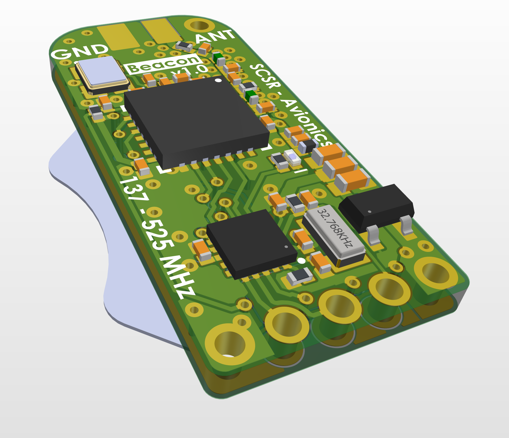
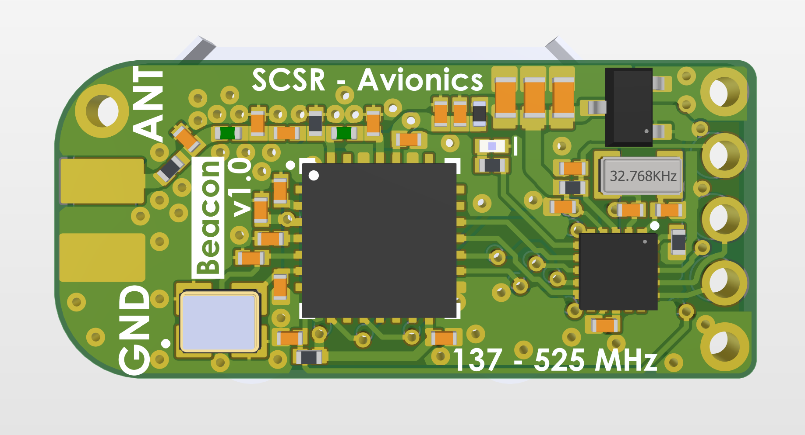
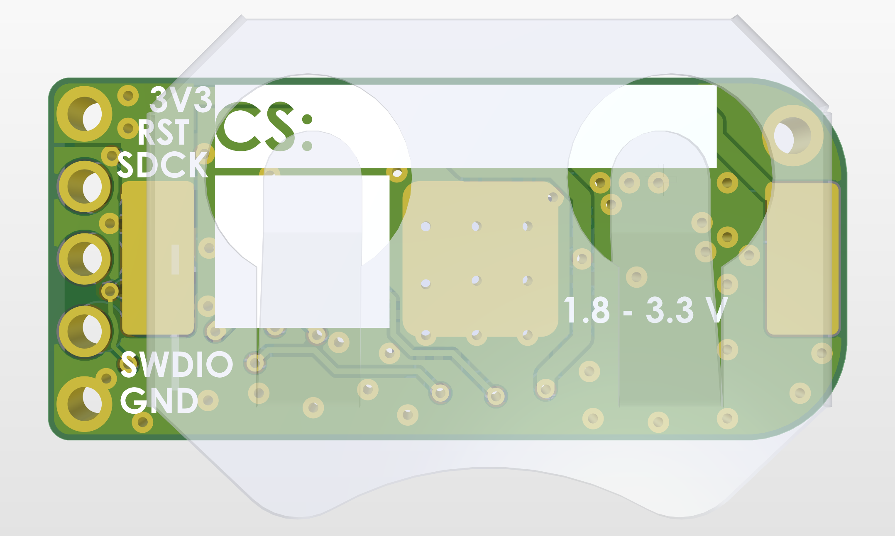

# Rocket Beacon



An ultra-compact, low-power Morse code beacon designed for VHF/UHF rocket, high-altitude balloon tracking, and foxhunting.

## Hardware Specifications

| Parameter | Specification |
| --- | --- |
| Microcontroller | STM32L011F3U6 |
| Radio Transceiver | Semtech SX1276 |
| Frequency Range | 136 MHz – 525 MHz |
| Operating Voltage | 1.8V to 3.6V DC |
| Supported Battery Size | 20 mm Coincell |

## Mechanical Specifications

<p align="center">
  
  
</p>

| Parameter | Specification |
| --- | --- |
| Board Dimensions | 12x27 mm |
| PCB Thickness (no components) | 1.6 mm |
| Layer Count | 2 Layers |
| Weight | Scale shows 0 so call it 1.5 g with the antenna |
| RF Connector | Raw Pad that you solder to |
| Mounting Holes | 2x M1.2 (the gnd header acts as the other one) |

The 3D model can be found in [`hardware/3DModel`](hardware/3DModel)

## Legal and Regulatory Compliance (Canada)

Operation of this device in Canada requires a valid **Amateur Radio Operator Certificate with Basic Qualification** issued by Innovation, Science and Economic Development Canada (ISED). Licensing may be different for you, ensure to check local radio regulations.

### Permissible Canadian Frequency Allocations

While the hardware synth supports 136 MHz to 525 MHz, transmissions must strictly adhere to amateur allocations in your country. For Canada they are as follows:

* **2-Meter Band (144.000 MHz – 148.000 MHz):** Propagation beacons typically operate between 144.200 MHz and 144.275 MHz. FM audio telegraphy is permitted on 146.520 MHz national calling or designated simplex channels. See [RAC 2 m Band Plan](https://www.rac.ca/mivahih/2021/01/TwoMetre_Bandplan_ND2020TCA.pdf)/) 
* 
* **1.25-Meter Band (222.000 MHz – 225.000 MHz):** Secondary weak-signal and beacon band. See [RAC 1.25 m Band Plan](https://www.rac.ca/220-mhz-135-cm-page/)
* 
* **70-Centimeter Band (430.000 MHz – 450.000 MHz):** CW/FM propagation test allocations. See [RAC 70 cm Band Plan](https://www.rac.ca/432-mhz-70-cm-page/)

## Quarter-Wave Whip Antenna Calculation

To construct a simple quarter-wave ($\lambda/4$) resonant wire antenna attached directly to the RF output pad, calculate the required element length using the following formulas:

$$\text{Length (cm)} = \frac{7125}{f_{\text{MHz}}}$$

$$\text{Length (inches)} = \frac{2805}{f_{\text{MHz}}}$$

### Sample Calculations

* **For 144.200 MHz (2m Beacon):**
  $$L = \frac{7125}{144.2} \approx 49.41\text{ cm } (19.45\text{ in})$$

* **For 432.100 MHz (70cm Beacon):**
  $$L = \frac{7125}{432.1} \approx 16.49\text{ cm } (6.49\text{ in})$$

## Firmware Overview

The firmware is written in C using bare-metal register access alongside light STM32CubeL0 components to fit within the 8 KB Flash memory limit of the STM32L011.

All operational parameters (callsign, frequency, tone pitch, and interval timing) are edited directly in `include/main.h`:

```c
/* Editable User Configuration Parameters (Inc/main.h) */
#define BEACON_FREQUENCY_HZ (144200000UL) // target rf frequency in Hz (144.2 MHz RAC 2m simplex)
#define BEACON_CALLSIGN "YOUR CALLSIGN"   // callsign or ID string to transmit in morse code
#define BEACON_MESSAGE "ROCKET BKN"       // message to follow the callsign every interval minutes (suggest add "No RX")
#define BEACON_ID_INTERVAL_MIN (10U)      // time between every identification in minutes (NO MORE THAN 30 in Canada)
#define BEACON_INTERVAL_SEC (10U)         // wait time between beacon transmissions in seconds
#define BEACON_MORSE_WPM (15U)            // morse code speed in words per minute
#define BEACON_TONE_FREQ_HZ (392U)        // audio pitch tone frequency in Hz
```
Now I don't recommend touching anything else because the code is 7.99 KB and that is with *very* heavy optimization which is why some of the functions are a little funky.


## PCB Fabrication & Ordering Guide

### 1. Ordering PCBs

1. Download the zipped production files from [`hardware/ManufacturingOutput.zip`](hardware/ManufacturingOutput.zip).
2. Upload the `.zip` archive to any standard PCB manufacturer (e.g., JLCPCB, PCBWay, Elecrow).
3. Use the following recommended fabrication settings:
   * **Layers:** 2
   * **Base Material:** FR-4
   * **Board Thickness:** 1.6 mm (or 1.0 mm for if you want, but the stiffness of the board will be less)
   * **Copper Weight:** 1 oz
   * **Surface Finish:** HASL or ENIG (if you are rich)

### 2. Component Acquisition & Assembly

I highly recommend having a fab do the assembly for you due to the tiny size of this thing unless the heat gun was the first thing you grabbed as a child. The Pick and Place can be found in * [`hardware/PickPlace.zip`](hardware/PickPlace.zip)

All required surface-mount resistors, capacitors, inductors, STM32 MCU, and SX1276 ICs are listed with exact Manufacturer Part Numbers (MPNs) in the Bill of Materials:
* [`hardware/BOM/BOM.xlsx`](hardware/BOM/BOM.xlsx) - Import directly into DigiKey, Mouser, or LCSC BOM managers.

## Building and Flashing

### Requirements

* [PlatformIO Core](https://platformio.org/) or VS Code with the PlatformIO extension
* ST-Link V2 SWD Programmer, or similar

### SWD Pinout Connections

| ST-Link V2 Pin | Target Board Pins (left to right) |
| --- | --- |
| GND | GND |
| SWDIO | SWDIO |
| SWCLK | SWCLK |
| nRST | nRST|
| 3.3V | VCC |


### Build Commands

```bash
# Clone the repository
git clone https://github.com/your-username/stm32-sx1276-vhf-beacon.git
cd stm32-sx1276-vhf-beacon

# Compile firmware
pio run

# Flash target MCU via ST-Link
pio run -t upload
```

## Hardware Files

* [`hardware/Documentation/Schematic.pdf`](hardware/Documentation/Schematic.pdf) - Full circuit schematic
* [`hardware/ManufacturingOutput.zip`](hardware/ManufacturingOutput.zip) - Manufacturing Gerber files
* [`hardware/BOM/BOM.csv`](hardware/BOM/BOM.xlsx) - Bill of materials

## License

This project was designed by Goran Staznik and licensed to Space Concordia Solid Rocketry for team and competition use. Hardware schematics, layouts, and firmware are shared freely under the CC BY-NC-SA 4.0 license for individual makers, hams, hobbyists, and other student rocketry teams (except for McGill) to build, modify, and learn from. Commercial production, sale, or use by corporate entities is strictly prohibited without prior written permission.
